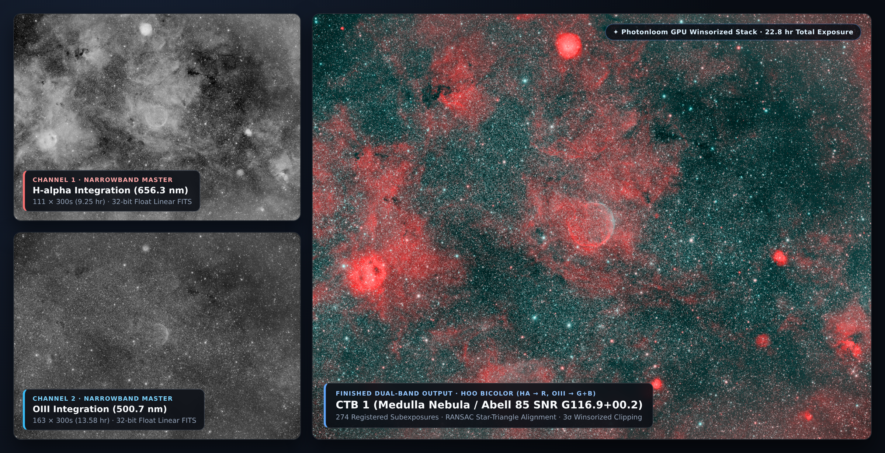
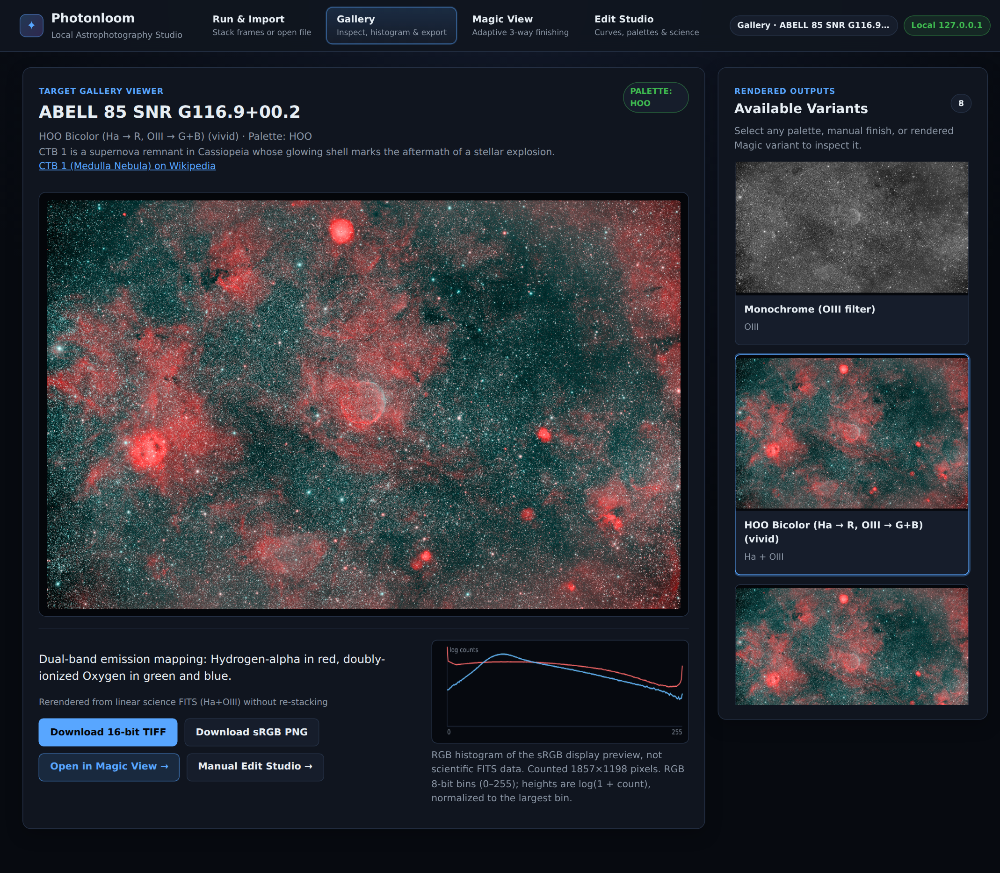
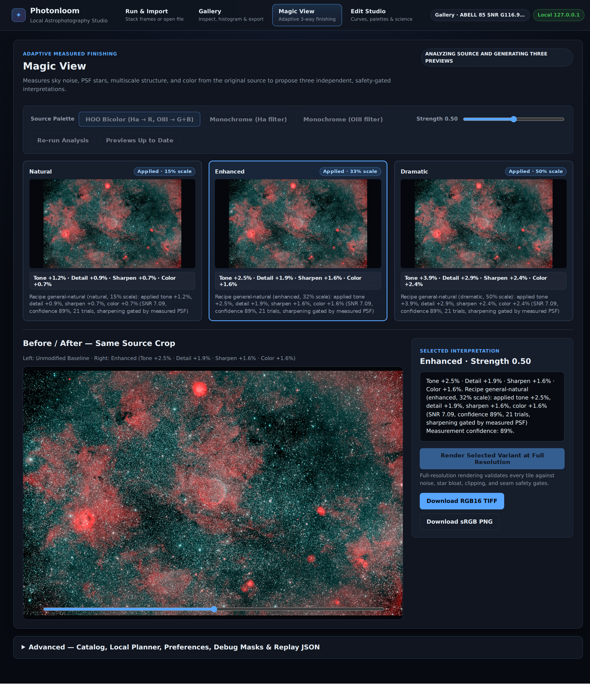
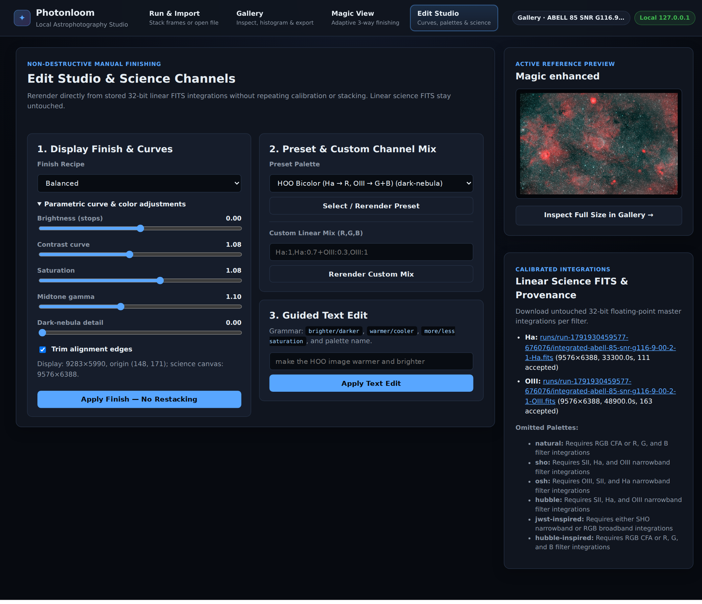
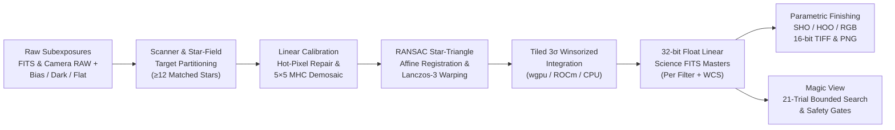

<div align="center">

# ✦ Photonloom

### **From Photons to Masterpieces**
*High-performance Rust astrophotography calibration, star-triangle registration, GPU Winsorized stacking, and adaptive narrowband studio.*

[](https://github.com/supernovae/photonloom/actions)
[](https://github.com/supernovae/photonloom)
[](https://github.com/supernovae/photonloom#hardware-acceleration--gpu-probe)
[-10b981?style=flat-square)](https://github.com/supernovae/photonloom#local-web-studio-photonloom)
[](https://github.com/supernovae/photonloom#licensing-notice)

[**Quick Start**](#-quick-start) · [**Web Studio**](#-local-web-studio-photonloom) · [**Magic View**](#-magic-view-adaptive-measured-finishing) · [**Palettes**](#-spectral--artistic-palettes) · [**Architecture**](#-processing-pipeline) · [**Docker & K8s**](#-container--kubernetes-deployment)

---



<sub>
  <strong>Real Narrowband Output:</strong> 274×300s (22.8 hr) $H\alpha$ + $O\text{III}$ integration of <strong>CTB 1 (Medulla Nebula / Abell 85 SNR G116.9+00.2)</strong> captured on a RedCat 51 (250 mm) and processed end-to-end by Photonloom.<br>
  Inspect the bundled example outputs directly in the repo: <a href="docs/assets/ctb1-hoo-vivid.png"><strong>8-bit sRGB Preview PNG</strong></a> · <a href="docs/assets/example-ctb1-hoo-rgb16.tiff"><strong>16-bit Linear-Light RGB TIFF</strong></a>
</sub>

</div>

---

## 🧭 Pick your flow

| Flow | Start here | Best for |
| :--- | :--- | :--- |
| **Studio** | `photonloom` | Opens the browser to the local, loopback-only studio. |
| **One-shot** | `photonloom inspect DIR` then `photonloom run DIR` | Preview the observation plan, then process one folder. |
| **Unattended** | `photonloom watch DIR` / `photonloom serve --watch DIR` / [Kubernetes](#-container--kubernetes-deployment) | Reprocess as new subs arrive, headlessly or with a live studio. |

---


## ✨ Why Photonloom?

Astrophotography pipelines often force a choice between complex manual multi-step GUI workflows and opaque black-box scripts that destroy linear sensor data. **Photonloom** is a single-binary Rust engine and local web studio built around scientific data integrity:

| Pillar | What Photonloom Does |
| :--- | :--- |
| **One-Command Folder Workflow** | Point `photonloom run` at a directory of FITS (`.fit`, `.fits`, `.fts`) or camera RAW (`.dng`, `.cr2`, `.cr3`, `.nef`, `.arw`, `.raf`, `.rw2`) subexposures and calibration frames (`bias`, `dark`, `flat`, `flatdark`). Source files are never modified. |
| **Honest Linear Calibration** | Decodes primary 2D FITS (honoring `BSCALE`/`BZERO`) and explicit 3D RGB cubes (`CTYPE3='RGB'`). Unpacks native camera RAW Bayer/mono mosaics via LibRaw (`rsraw`)—never using camera-baked `process()` pixels. Pairs calibration masters strictly by sensor, geometry, CFA, binning, gain/ISO ($\pm 2\%$), temperature ($\pm 2\,^\circ\text{C}$), and exposure ($\pm 5\%$ or bias-anchored dark scaling). Repairs hot pixels on same-CFA neighbors before Malvar-He-Cutler $5\times 5$ linear demosaicing. |
| **Geometric Star Registration** | Partitions multi-target folders automatically by star-field overlap ($\ge 12$ matched stars), using FITS `OBJECT` only as a display label. Aligns subexposures via geometric star triangles and RANSAC affine transforms ($\ge 12$ inliers, $\le 2.0\text{ px}$ RMS, $\ge 50\%$ overlap), warping frames with Lanczos-3 interpolation and aligning all filters to a common target grid. |
| **GPU & CPU Winsorized Stacking** | Streams bounded adaptive tiles (up to $512\times 512$) from disk-spooled calibrated frames using exposure / inverse-background-variance weighting and 3-iteration $3\sigma$ Winsorized sigma clipping across all accepted frames in a single pass—via portable `wgpu` compute shaders (Vulkan, Metal, DX12), optional dynamic ROCm HIP on Linux/WSL2, or parallel `rayon` CPU workers. |
| **Truthful Spectral Palettes** | Renders only feasible palettes from present filters (`natural`, `hoo`, `sho`, `osh`, `hubble`, `jwst-inspired`, `hubble-inspired`, and custom linear `--mix`). Never fabricates narrowband channels ($H\alpha$, $O\text{III}$, $S\text{II}$) from broadband RGB. |
| **Non-Destructive Finishing & Magic View** | Preserves full-resolution 32-bit float linear FITS science integrations alongside cropped 16-bit RGB TIFFs and 8-bit sRGB PNG previews. Re-finish curves, palettes, or adaptive **Magic View** interpretations anytime without recalibrating or restacking. |

---

## 🖥️ Local Web Studio (`photonloom`)

Run `photonloom` to open the browser, or `photonloom serve` to start without opening it. The zero-dependency studio binds strictly to loopback (`127.0.0.1` / `::1`)—no cloud accounts, telemetry, or external CDNs. Its live **Activity** console shows processing stages, detail messages, and progress while runs and Magic View work, so long jobs are never silent.

### 1. Target Gallery & Display Histogram
Inspect rendered narrowband and broadband variants, compare the real-time sRGB display histogram, read curated target astronomy context, and download 16-bit TIFFs, sRGB PNGs, or 32-bit float FITS masters.

<p align="center">
  
</p>

### 2. Magic View — Adaptive 3-Way Measured Finishing
Compare **Natural**, **Enhanced**, and **Dramatic** interpretations side-by-side with an interactive Before/After split slider. Every candidate is optimized across a 21-slot bounded search and gated against clipping, sky noise amplification, stellar FWHM bloat, halo overshoot, and mask seams.

<p align="center">
  
</p>

### 3. Edit Studio & Science Channels
Adjust parametric tone curves (exposure, contrast, saturation, midtone gamma, noise-gated dark-nebula local contrast), compose custom linear channel mixes (`Ha:1,Ha:0.7+OIII:0.3,OIII:1`), or apply guided natural-language edits directly from stored 32-bit linear FITS masters without restacking.

<p align="center">
  
</p>

---

## 🔄 Processing Pipeline



---

## 🚀 Quick Start

### 1. Try Immediately (Zero External Dataset Required)

You can exercise Photonloom right after cloning using either the bundled **16-bit linear-light RGB TIFF** (`docs/assets/example-ctb1-hoo-rgb16.tiff`) or the deterministic **synthetic multi-filter observation generator** (`make_fixture`):

```bash
# Open the local studio immediately (no dataset required)
cargo run --release --

# Option A: Run Magic View directly on the bundled 16-bit linear-light CTB 1 TIFF
cargo run --release -- magic view docs/assets/example-ctb1-hoo-rgb16.tiff \
  --transfer linear \
  --variant enhanced --strength 0.5

# Option B: Generate synthetic multi-filter observations (Ha, OIII, SII, RGB FITS + DNG)
cargo run --release --example make_fixture -- /tmp/photonloom-fixture
# Preview the frame counts, calibration coverage, feasible palettes, and warnings without processing pixels
cargo run --release -- inspect /tmp/photonloom-fixture
cargo run --release -- run /tmp/photonloom-fixture \
  --output /tmp/photonloom-gallery \
  --accelerator auto --magic-view

# Open the completed gallery in the local studio
cargo run --release -- serve --gallery /tmp/photonloom-gallery --open
```

### 2. Process Your Own Observations

Point `photonloom inspect` at your night's folder for a quick, metadata-only plan, then `photonloom run` for full processing. The folder may contain light frames and optional calibration frames:

```bash
photonloom inspect /path/to/observations
# Machine-readable plan:
photonloom inspect /path/to/observations --json

# Full calibration, star registration, GPU/CPU integration, and gallery rendering
photonloom run /path/to/observations \
  --output /path/to/gallery \
  --accelerator auto

# Open the completed gallery in the local web app without reprocessing
photonloom serve --gallery /path/to/gallery --open
```

### 3. Let a Folder Run Overnight

Copy each night's subs into a watched folder; Photonloom refreshes the science masters, gallery, and **Magic View** interpretations by morning. `watch` polls supported frame files (default every 30 seconds) and waits for the folder to be quiet for `--settle` seconds (default 120) before starting, so files being copied are not processed prematurely. On startup, files whose modification time is already older than the settle window count as quiet, so a cron `--once` pass over last night's frames starts immediately. Each distinct folder snapshot runs **once**; failed snapshots are not retried until files change again. Magic View is on by default (`--no-magic` turns it off). When `serve --watch` restarts, the existing gallery in the output directory is shown immediately.

```bash
# Headless watcher; keep the latest three runs by default
photonloom watch /path/to/observations --output /path/to/gallery

# Live studio and watcher together, or a single settled headless pass for cron
photonloom serve --watch /path/to/observations --output /path/to/gallery --open
photonloom watch /path/to/observations --output /path/to/gallery --once --settle 300
```

Use `--interval 30` to tune polling, `--settle 300` for a five-minute quiet period, and `--keep-runs 5` to retain five run directories instead of the default three. Older runs are pruned without removing the run referenced by the current gallery manifest. Watch state and the last result live in `<OUTPUT>/.photonloom-watch.json`; keep this file with the output to preserve once-per-snapshot behavior across restarts.

### 4. Re-finish Without Restacking

Re-finish an existing gallery from its stored 32-bit float FITS integrations without recalibrating or restacking:

```bash
# Apply a parametric display preset and curve overrides
cargo run --release -- finish /path/to/gallery \
  --finish-preset dark-nebula --exposure 0.25 --saturation 1.12

# Render a starless nebula variant (or screen-blended star reduction) with GPU offloading
cargo run --release -- finish /path/to/gallery --starless
cargo run --release -- finish /path/to/gallery --star-mode reduced --star-blend 0.45

# Render a custom linear channel mix
cargo run --release -- run /path/to/observations \
  --output /path/to/custom-gallery \
  --mix 'Ha:1,Ha:0.7+OIII:0.3,OIII:1'

# Apply a deterministic natural-language edit (including starless / star reduction) without restacking
cargo run --release -- edit /path/to/gallery "make the HOO image warmer and brighter"
cargo run --release -- edit /path/to/gallery "make the SHO image starless"
```

| Finish Control | Flag | Range | Notes |
| :--- | :--- | :--- | :--- |
| **Preset** | `--finish-preset` | `balanced`, `neutral`, `vivid`, `dark-nebula` | `neutral` disables additional tone/detail curves while keeping background neutralization & asinh stretch |
| **Exposure** | `--exposure` | `-4.0` … `+4.0` stops | Foreground-preserving exposure adjustment |
| **Contrast** | `--contrast` | `0.5` … `1.8` | Monotonic pivoted contrast curve |
| **Saturation** | `--saturation` | `0.0` … `1.8` | Hue-preserving gamut-safe saturation |
| **Midtone Gamma** | `--gamma` | `0.5` … `2.0` | Midtone lift/compression |
| **Dark-Nebula Detail** | `--local-contrast` | `0.0` … `0.3` | Noise-gated multiscale local contrast that avoids star-halo ringing |
| **Starless / Star Mode** | `--starless` / `--star-mode` | `standard`, `starless`, `reduced`, `stars-only` | GPU-offloaded (`wgpu` / ROCm `HIP` / `rayon`) 24-pass multiscale harmonic star inpainting & unscreen/screen star separation |
| **Star Screen Blend** | `--star-blend` | `0.0` … `1.0` | Screen-reblend weight for separated stars (`0.0` = starless, `0.45` = reduced stars, `1.0` = full stars) |
| **Edge Trimming** | `--keep-edges` | flag (default: trim) | By default, display TIFF/PNGs crop to the common registered overlap while 32-bit FITS retain the full sensor canvas |
---

## 🪄 Magic View (Adaptive Measured Finishing)

**Magic View** is an opt-in, non-generative finishing engine for one-shot runs (and is on by default in watch). It measures sky background MAD/high-frequency noise, stellar PSF profiles (FWHM & eccentricity), multiscale structure contrast, and chroma separation to propose three independent candidates: **Natural** ($0.30\times$), **Enhanced** ($0.65\times$), and **Dramatic** ($1.00\times$). `photonloom magic view INPUT` no longer requires `--output`: for a gallery directory, results go in that directory; for a file, they go in `<file-parent>/<file-stem>-magic`. Pass `--output DIR` to override.

```bash
# Analyze a gallery target and render three previews + a full-resolution Enhanced output
photonloom magic view /path/to/gallery \
  --output /path/to/magic-out \
  --palette hoo --variant enhanced --strength 0.5

# Analyze and render a starless nebula Magic View interpretation with GPU offloading
photonloom magic view /path/to/gallery \
  --output /path/to/magic-starless \
  --palette hoo --variant enhanced --strength 0.5 --starless
# Render another variant/strength from an existing session
photonloom magic render /path/to/magic-out/magic/<digest>/<target>/session.json \
  --variant dramatic --strength 0.5

# Replay a versioned parameter proposal exported from the Web Studio
photonloom magic view /path/to/image.fits \
  --output /path/to/magic-out \
  --magic-parameters /path/to/exported-parameters.json
```

### Safety Gates & Provenance Guarantees
Every preview and full-resolution tile is checked against strict quantitative gates before acceptance (backing off through $1.0\times \to 0.5\times \to 0.25\times \to 0.0\times$ unmodified baseline if any gate trips):
- **Clipping Guard**: Newly clipped pixels $\le 0.1\%$ of initially unclipped valid pixels.
- **Sky Noise Ceiling**: Background MAD and high-frequency residual $\le 1.2\times$ baseline.
- **Stellar Profile Preservation**: Matched star FWHM change $\le 10\%$ and annular bright-star halo overshoot $\le 3\sigma_{\text{sky}}$.
- **Faint-Signal Retention**: Faint nebulosity retention $\ge 95\%$ and mask-edge seam residual $\le 2\sigma_{\text{sky}}$.
- **Offline Catalog Matching**: Uses validated `RA---TAN` / `DEC--TAN` WCS headers against the bundled 12,098-object OpenNGC catalog (`data/catalog/openngc-positions.csv`, [CC BY-SA 4.0](data/catalog/LICENSE.OpenNGC.txt)) to select morphology-appropriate bounds (`emission`, `spiral-galaxy`, `cluster`, `dark-nebula`, `planetary`, `hdr`, or `general-natural`). Optional `--catalog-online` queries SIMBAD over HTTPS only when valid WCS is present.

See **[Magic View Internals](docs/magic-view.md)** for the full session schema, optimizer design, and safety gate equations.

---

## 🎨 Spectral & Artistic Palettes

Photonloom classifies frames from FITS `IMAGETYP`/`FILTER` headers, parent folder names (`lights/`, `darks/`, `bias/`, `flats/`, `flatdarks/`), and filename tokens—stopping with a clear error on conflicting metadata rather than guessing.

| Palette ID | Channel Mapping ($R, G, B$) | Required Inputs | Type |
| :--- | :--- | :--- | :--- |
| `natural` | Broadband $R, G, B$ or Bayer CFA / RGB cube | `RGB` or `R` + `G` + `B` | True Color |
| `hoo` | $R = H\alpha,\; G = O\text{III},\; B = O\text{III}$ | `Ha` + `OIII` | Narrowband Bicolor |
| `sho` | $R = S\text{II},\; G = H\alpha,\; B = O\text{III}$ | `SII` + `Ha` + `OIII` | Narrowband 3-Band |
| `osh` | $R = O\text{III},\; G = S\text{II},\; B = H\alpha$ | `OIII` + `SII` + `Ha` | Narrowband 3-Band |
| `hubble` | Tuned Gold/Teal $S\text{II} / H\alpha / O\text{III}$ balance | `SII` + `Ha` + `OIII` | Narrowband 3-Band |
| `jwst-inspired` | Crisp amber/cyan spectral mapping | `SHO` or `RGB` | Artistic (Labeled) |
| `hubble-inspired` | Warm/cool broadband contrast mapping | `RGB` or `R` + `G` + `B` | Artistic (Labeled) |
| `monochrome-<ch>` | Single-filter calibrated grayscale | Any single filter (`L`, `Ha`, `OIII`, `SII`, …) | Monochrome |

### Emitted Gallery Structure

Each run writes into an isolated `<OUTPUT>/runs/<run-id>/` directory and atomically updates the root `manifest.json` and offline-openable `index.html`:

```text
<OUTPUT>/
├── index.html                                  # Offline static gallery linking to the latest run
├── manifest.json                               # Root GalleryManifest JSON with full frame provenance
└── runs/
    └── run-<timestamp>-<pid>/
        ├── index.html
        ├── manifest.json
        ├── integrated-<target>-Ha.fits         # 32-bit float linear science master (full canvas)
        ├── integrated-<target>-OIII.fits
        ├── integrated-<target>-SII.fits
        ├── integrated-<target>-RGB.fits
        ├── <target>-hoo.tiff                   # 16-bit RGB linear-light finished TIFF
        ├── <target>-hoo.png                    # 8-bit sRGB preview PNG (≤ 2048 px longest side)
        └── ...
```

---

## ⚡ Hardware Acceleration & GPU Probe

Verify your system's GPU adapter and numerical agreement between CPU and GPU Winsorized clipping kernels without processing a full dataset:

```bash
cargo run --release --example gpu_probe
```

- **Portable GPU Compute (`wgpu`)**: Runs WGSL compute shaders across Vulkan, Metal, and DirectX 12.
- **Optional ROCm / HIP (Linux & WSL2)**: Dynamically loads `libamdhip64` / `libhiprtc` at runtime when present (`src/hip_stack.hip`), with zero build-time dependency on ROCm.
- **Parallel CPU (`rayon`)**: Bounded worker scratch and streaming tile warps keep memory usage predictable even on 100+ megapixel sensors.

---

## 🧠 Optional Local Models (Loopback LLM & Cosmic Clarity)

Core processing requires **no** Python, PyTorch, or LLM server. Two opt-in local-only integrations are supported:

1. **Loopback `llama-server` for Free-Form Text Edits & Magic Planning**:
   ```bash
   photonloom edit /path/to/gallery \
     "cool the colors a little and brighten by half a stop" \
     --local-llm http://127.0.0.1:8080
   ```
   Endpoints are verified to be strictly on loopback (`127.0.0.1` / `::1`) and constrained to bounded JSON parameters before rerendering from linear FITS.

2. **Cosmic Clarity Star-Shape & Denoise Restoration (`--restore`)**:
   ```bash
   pip install -r ml/requirements-restore.txt
   photonloom models install
   photonloom run /path/to/observations --output /path/to/restored --restore
   ```
   Downloads and SHA-256-verifies pinned MIT-licensed [Seti Astro Cosmic Clarity](https://github.com/setiastro/cosmicclarity) weights (`weights_only=True`), adding an explicitly labeled `*-restored` (`AI-Enhanced`) variant while keeping all un-restored variants and scientific FITS untouched.

---

## 🐳 Container & Kubernetes Deployment

Photonloom runs headlessly in Docker and Kubernetes using the same `photonloom` binary without requiring a GPU node:

```bash
# One-shot: the image's default command processes /observations into /results
docker run --rm \
  -v /path/to/observations:/observations:ro \
  -v /path/to/results:/results:rw \
  ghcr.io/supernovae/photonloom:latest

# Headless watcher: mount an incoming folder that receives new subs
docker run --rm \
  -v /path/to/observations:/observations:ro \
  -v /path/to/results:/results:rw \
  ghcr.io/supernovae/photonloom:latest \
  watch /observations --output /results

# Studio in Docker: host networking is required because the server binds loopback only
docker run --rm --network host \
  -v /path/to/observations:/observations:ro \
  -v /path/to/results:/results:rw \
  ghcr.io/supernovae/photonloom:latest \
  serve --watch /observations --output /results --bind 127.0.0.1:8787

# Or build locally from Dockerfile
docker build -t photonloom:latest .
```

| Kubernetes workload | Manifest | Use when |
| :--- | :--- | :--- |
| **Job** | `deploy/photonloom-job.yaml` | One-off processing of a complete observation folder. |
| **CronJob** | `deploy/photonloom-cronjob.yaml` | Nightly headless batch; one settled snapshot per scheduled run. |
| **Deployment** | `deploy/photonloom-watch.yaml` | Continuous watch plus live studio; one replica, replacing rather than overlapping pods. |

```bash
# Provision PVCs first; for the optional single-node MicroK8s hostPath example,
# prepare the node paths as noted in the manifest and apply it:
kubectl apply -f deploy/photonloom-microk8s-hostpath.yaml

# Choose ONE workload:
# One-off:
kubectl apply -f deploy/photonloom-job.yaml
kubectl wait --for=condition=complete --timeout=300s job/photonloom-run
kubectl logs job/photonloom-run

# OR nightly unattended batch:
kubectl apply -f deploy/photonloom-cronjob.yaml
# OR continuous watching with a live studio:
kubectl apply -f deploy/photonloom-watch.yaml
kubectl port-forward deploy/photonloom-watch 8787:8787
```

Use the manifests as **alternatives** for the same result directory rather than running Job, CronJob, and Deployment simultaneously. The studio deliberately listens on pod loopback only; `kubectl port-forward` reaches that loopback listener without exposing a cluster Service. The observation claim must be readable by Photonloom while your capture/copy process can add files (shared RWX storage with a read-only mount in the watcher); result storage must be writable by UID 10001. For a single-node MicroK8s observatory with host paths such as `/srv/astro/incoming`, see `deploy/photonloom-microk8s-hostpath.yaml`.

---

## 🛠️ Build Prerequisites & Licensing

### Native Build Prerequisites
- **Rust**: Stable toolchain (`rust-toolchain.toml`, Rust 2024 edition).
- **C/C++ & Build Tools**: C/C++ compiler (`gcc`/`clang`/MSVC), `cmake`, `pkg-config`, and `libclang` (required by `bindgen` for `rsraw-sys` and `fitsio-sys`).
  - **Ubuntu / Debian**: `sudo apt-get install build-essential cmake clang libclang-dev pkg-config zlib1g-dev`
  - **macOS**: `brew install cmake pkg-config`
  - **Windows**: Visual Studio C++ Build Tools, LLVM/Clang, and CMake.

### Licensing Notice
- **Photonloom**: MIT License.
- **OpenNGC Catalog Derivative** (`data/catalog/openngc-positions.csv`): [CC BY-SA 4.0](data/catalog/LICENSE.OpenNGC.txt).
- **CFITSIO** (`fitsio` / `fitsio-src`): NASA/HEASARC CFITSIO permissive license.
- **LibRaw** (`rsraw` / `rsraw-sys`): Dual-licensed under LGPL-2.1 or CDDL-1.0.
- **Seti Astro Cosmic Clarity weights** (opt-in via `photonloom models install`): MIT License, Copyright (c) 2024 Seti Astro (Franklin Marek).
